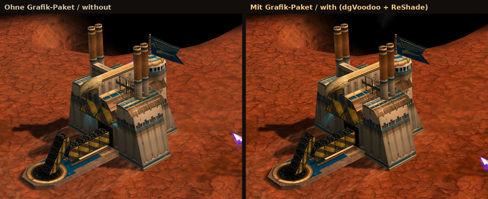
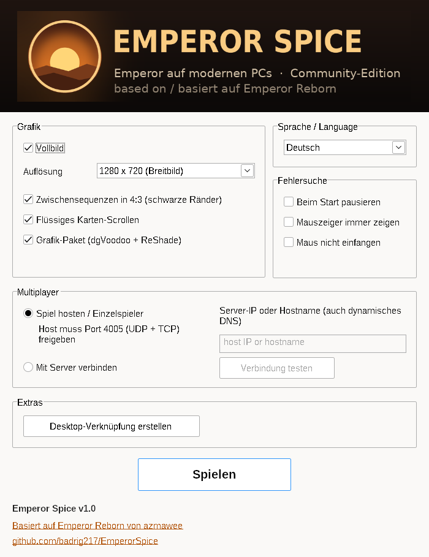

<b>Emperor: Schlacht um Dune (2001) auf modernen Windows-PCs – Breitbild, hohe Auflösung, schärfere Grafik, Deutsch &amp; Englisch.</b> 
<i>Emperor: Battle for Dune on modern Windows PCs – widescreen, high resolution, sharper graphics, German &amp; English.</i>

<a href="#deutsch">Deutsch</a> · <a href="#english">English</a>

---

## Deutsch

**Emperor Spice** ist ein kostenloser Community-Patch, der *Emperor: Schlacht um Dune* auf Windows 10 und 11 wieder spielbar macht – ohne die alten, auf modernen Systemen kaputten CD-Installer und ohne Gebastel. Er basiert auf [Emperor Reborn](https://github.com/azmawee/EmperorReborn) von azmawee und erweitert es um die deutsche Version, eine zweisprachige Oberfläche und ein Grafik-Paket.

### Was Emperor Spice kann

- **Deutsche und englische Spielversion** – der Patch 1.09 (`EM109DE.EXE` oder `EM109EN.EXE`) wird automatisch erkannt.
- **Eigener Installer** – kopiert das Spiel von deinen 4 CDs (oder eingebundenen ISO-Abbildern) und spielt den Patch ein. Die alten Installer und der SafeDisc-Kopierschutz, die unter Windows 10/11 nicht mehr laufen, werden nicht benötigt.
- **Echtes Breitbild** (16:9) bis 2560×1440, inklusive angepasster Seitenleiste und Menüs.
- **Grafik-Paket** (abschaltbar): 16-fache anisotrope Texturfilterung über dgVoodoo2 sowie Kantenglättung (SMAA), mehr Kontrast und Nachschärfen über ReShade.
- **Zweisprachiger Launcher** (Deutsch/Englisch) mit moderner Oberfläche.
- **Flüssiges Karten-Scrollen**, Zwischensequenzen wahlweise im Originalformat 4:3.
- **Multiplayer** über direkte IP-Verbindung (der alte Westwood-Online-Server existiert nicht mehr).
- **Desktop-Verknüpfung** wird nach der Installation automatisch angelegt.
- **Geld-Cheat** (optional, nur Einzelspieler): im Launcher unter „Extras“ einschalten, dann gibt **Strg+Umschalt+G** im Spiel +25.000 Credits. Im Multiplayer ist er gesperrt.

In Arbeit: Installation direkt aus ISO-Dateien.

### Was du brauchst

- Windows 10 oder 11 (64 Bit)
- **Dein eigenes Spiel**: die 4 Original-CDs von *Emperor: Schlacht um Dune* (deutsch oder englisch) oder ISO-Abbilder davon, die du in Windows einbinden kannst. Das Spiel ist **nicht** enthalten.
- **Den offiziellen Patch 1.09**: `EM109DE.EXE` (deutsch) bzw. `EM109EN.EXE` (englisch). Er ist urheberrechtlich geschützt und deshalb nicht enthalten, war aber ein kostenloser Download und ist z. B. auf Fan-Seiten wie CNCNZ noch erhältlich.

### Installation

1. **Herunterladen**: Lade die aktuelle `EmperorSpice-v….zip` unter [Releases](../../releases) herunter.
2. **Entpacken** in einen eigenen Ordner, z. B. `D:\Spiele\EmperorSpice`.
   **Wichtig:** Der Pfad darf keine Umlaute oder Sonderzeichen enthalten (also nicht `C:\Users\Jürgen\…`).
3. **Patch dazulegen**: Kopiere `EM109DE.EXE` (oder `EM109EN.EXE`) in denselben Ordner wie `EmperorSpice.exe`.
4. **CDs bereitlegen**: CD 1 einlegen bzw. die ISO-Abbilder einbinden (Doppelklick auf die ISO). Die CDs heißen `EMPEROR1` bis `EMPEROR4`; die weiteren CDs fragt der Installer nacheinander ab.
5. **`EmperorSpice.exe` starten** und die Frage „Spiel jetzt hier installieren?“ mit OK bestätigen.
   - Erscheint die blaue Windows-Meldung *„Der Computer wurde durch Windows geschützt“*: auf **„Weitere Informationen“** und dann **„Trotzdem ausführen“** klicken. Die Meldung kommt, weil das Programm nicht kostenpflichtig digital signiert ist.
6. Nach der Installation liegt eine Verknüpfung **„Emperor Spice“** auf dem Desktop. Im Launcher Auflösung wählen und auf **Spielen** klicken.

Danach brauchst du die CDs nicht mehr.

### Das Grafik-Paket

Ist der Haken **„Grafik-Paket (dgVoodoo + ReShade)“** gesetzt (Standard), richtet der Launcher beim Start alles selbst ein:

| Taste | Funktion |
|---|---|
| **Rollen** (Scroll Lock) | Effekte ein/aus – zum direkten Vergleich |
| **Pos1** (Home) | ReShade-Menü öffnen, z. B. um Schärfe oder Kontrast anzupassen |

Deine Änderungen im ReShade-Menü bleiben erhalten. Ohne Haken entfernt der Launcher die Dateien wieder, das Spiel läuft dann wie im Original.

> **Hinweis:** Bitte in dgVoodoo **keine** Kantenglättung (MSAA) einschalten – das Spiel bleibt damit beim Start hängen. Die Kantenglättung übernimmt ReShade (SMAA).

### Probleme?

- **Das Spiel startet nicht / hängt:** Im Ordner `data` liegt die Protokolldatei `emperor.txt`. Hänge sie bei einem [Issue](../../issues) an.
- **Warnung „Falsche Game.exe-Version“:** Die Installation ist nicht vollständig durchgelaufen oder es wurde ein anderer Patch verwendet. Im Dialog „Nein“ wählen, um neu zu installieren.
- **Texte im Spiel sehr klein:** Im Launcher eine der Auflösungen „Hochskaliert …, große UI“ wählen (Bild wird etwas weicher, Schrift größer).
- **Grafik-Paket ausprobieren ohne Risiko:** Haken im Launcher entfernen – alles ist wie vorher.

---

## English

**Emperor Spice** is a free community patch that makes *Emperor: Battle for Dune* playable again on Windows 10 and 11 – without the old CD installers that no longer work on modern systems. It is based on [Emperor Reborn](https://github.com/azmawee/EmperorReborn) by azmawee and adds support for the German game, a bilingual launcher and a graphics pack.

### Features

- **English and German game** – the v1.09 patch (`EM109EN.EXE` or `EM109DE.EXE`) is detected automatically.
- **Own installer** – copies the game from your 4 CDs (or mounted ISO images) and applies the patch; the original installer and the SafeDisc copy protection are not needed.
- **True 16:9 widescreen** up to 2560×1440, including the sidebar and menus.
- **Graphics pack** (optional): 16x anisotropic filtering via dgVoodoo2, plus SMAA anti-aliasing, contrast and sharpening via ReShade.
- **Bilingual launcher** (English/German) with a modern look.
- **Smooth map scrolling**, cutscenes optionally in their original 4:3.
- **Multiplayer** via direct IP (the old Westwood Online servers are gone).
- **Desktop shortcut** is created after installation.
- **Money cheat** (optional, single player only): enable it under "Extras" in the launcher, then **Ctrl+Shift+G** adds 25,000 credits. Disabled in multiplayer.

Work in progress: installing directly from ISO files.

### Requirements

- Windows 10 or 11 (64-bit)
- **Your own game**: the 4 original CDs (English or German) or ISO images of them. The game is **not** included.
- **The official v1.09 patch**: `EM109EN.EXE` or `EM109DE.EXE` (copyrighted, therefore not included; it was a free download and can still be found on fan sites such as CNCNZ).

### Installation

1. Download `EmperorSpice-v….zip` from [Releases](../../releases) and extract it to its own folder, e.g. `D:\Games\EmperorSpice` (**no special characters** in the path).
2. Copy `EM109EN.EXE` (or `EM109DE.EXE`) next to `EmperorSpice.exe`.
3. Insert disc 1 or mount the ISO images (discs `EMPEROR1`–`EMPEROR4`).
4. Run `EmperorSpice.exe` and confirm the installation. If Windows SmartScreen appears, click **"More info" → "Run anyway"** (the program is not commercially code-signed).
5. Use the **Emperor Spice** desktop shortcut from then on, pick a resolution and click **Play**.

**Graphics pack:** Scroll Lock toggles the effects, Home opens the ReShade menu. Do **not** enable MSAA in dgVoodoo – the game hangs with it; anti-aliasing is done by ReShade (SMAA).

**Problems?** Attach `data\emperor.txt` to an [issue](../../issues).

---

## Credits

Emperor Spice stands on the shoulders of others – thank you!

- **[Emperor Reborn](https://github.com/azmawee/EmperorReborn)** by azmawee – widescreen, HUD, upscaling, multiplayer and the launcher this project is built on ([original README](docs/EmperorReborn-README.md)).
- **[EmperorLauncher](https://github.com/wheybags/EmperorLauncher)** by Tom Mason (wheybags) – the original modern-Windows patch.
- **Moro** – in-game HUD/sidebar widescreen patch, shared in the Emperor community.
- **[dgVoodoo2](http://dege.freeweb.hu/dgVoodoo2/)** by Dege, **[ReShade](https://reshade.me)** by crosire, **[SweetFX](https://github.com/CeeJayDK/SweetFX)** by CeeJay.dk, SMAA by Jorge Jimenez et al.

Details and licences: [`THIRD-PARTY-NOTICES.txt`](THIRD-PARTY-NOTICES.txt).

## Disclaimer / Rechtliches

Emperor Spice is an unofficial fan project and not affiliated with Electronic Arts or Westwood Studios. *Emperor: Battle for Dune* and *Dune* are trademarks of their respective owners. No game files or EA patches are distributed. The Emperor Spice code is released under the MIT-0 license ([`license.txt`](license.txt)).

## Für Entwickler / Building

- Visual Studio 2022 (C++ workload), solution `EmperorLauncher.sln`, Release/x86.
- `package.ps1` builds and packages the zip; `fetch-graphics.ps1` adds the graphics pack. dgVoodoo2 and ReShade are taken unmodified from the [`thirdparty-v1`](../../releases/tag/thirdparty-v1) release and verified by SHA256; shaders are pinned to a commit.
- Every push builds automatically via GitHub Actions (artifact `EmperorSpice-ci`).
